# Common intelligent optimization algorithm improvement strategies: ① Cross-axis interleaving, ② Lens imaging inverse learning, ③ Dynamic inverse learning, ④ Sine and cosine, ⑤ Golden sine, ⑥ Adaptive convergence factor.

As the saying goes, "Teaching someone to fish is better than giving them a fish."
The improvement of intelligent algorithms serves as an innovative point that can be utilized in any paper or even patented at any time.
There are countless papers online discussing improvements to intelligent algorithms! However, if we count up the strategies for improvement, it's not hard to find them!
Previously, the author has introduced two commonly used strategies for improving intelligent algorithms. These include:
1. Levy flight, 2. Random walk, 3. Helical flight, 4. Gaussian random walk, 5. Triangular walk, 6. Gaussian mutation, 7. t-distribution perturbation mutation, 8. Adaptive t-distribution perturbation mutation, 9. Cauchy mutation, 10. Difference mutation.
To facilitate the learning and portability of code implementation for these strategies, the author has applied these more than ten strategies to the classic particle swarm optimization algorithm.
Therefore, as long as you understand the classic particle swarm optimization algorithm, comparing it with the improved particle swarm optimization algorithm will immediately help you grasp how these strategies are applied in intelligent optimization algorithms. By applying this principle, everyone will naturally improve other algorithms!
Here are the ten strategies previously introduced, with links provided below:
Common Intelligent Optimization Algorithm Improvement Strategies - Flight and Walk Chapter (Five Strategies) Can be used to improve all intelligent algorithms, making beginners also able to improve intelligent algorithms.
Common Intelligent Optimization Algorithm Improvement Strategies - Mutation Chapter (Five Mutation Strategies) Can be used to improve all intelligent algorithms, making beginners also able to improve intelligent algorithms.
In addition to the above ten strategies, the author will introduce six common improvement strategies in this issue.
These six strategies are:
1. Crossover, 2. Lens imaging reverse learning, 3. Dynamic reverse learning, 4. Sine, 5. Golden sine, 6. Adaptive convergence factor
Adding the above ten strategies, there are a total of sixteen intelligent algorithm improvement strategies.
Learning these sixteen strategies will make you astonished when you revisit related literature on improving intelligent algorithms; many strategies in the literature are indeed within these sixteen.
Let's now introduce the six new strategies for improvement!
To facilitate everyone's in-depth understanding of the latest six improvement strategies, the author has also applied these strategies to a simple yet understandable particle swarm algorithm. This approach aims to teach how to utilize these five strategies, making it convenient for future adaptation to other intelligent algorithms.
1. Cross and intersect
An article was found online about the strategy of zigzag, which is well written.
Regarding the strategy of cross-over, the author wishes to say that this strategy is essentially applicable to all intelligent algorithms and will significantly improve upon them. However, one drawback is that the introduction of this cross-over strategy will increase the complexity of the intelligent algorithm. Therefore, everything in the world seeks a balance and harmony between Yin and Yang!
If your actual engineering case's adaptive function model is relatively simple, then you might consider this strategy and it will likely yield good results. However, if the iteration of your actual engineering case model takes a long time each time, it is strongly recommended not to use this strategy. After all, when the program finishes running, you are probably also about to graduate.
References: Liang Ximing, Zhang Yang, Long Wen. Optimization Algorithm with Cross-Stranded Strategy for Spiders [J]. Mathematical Practice and Understanding, 2022, 52(12): 144-158.
② Lens imaging inverse learning (Inverse Learning)
The Reverse Learning Strategy, as a common improvement strategy for intelligent algorithms, can be found in many literatures on improving intelligent algorithms!
The main idea of lens imaging inverse learning is to generate an inverse position based on the current coordinates through the principle of convex lens imaging, which can expand the search range. This approach not only breaks out of the current position but also enlarges the search range, enhancing the diversity of the population.
Schematic diagram of lens imaging inverse learning strategy
The reverse learning formula based on the principle of lens imaging is as follows:
a and b represent the upper and lower bounds of the solution, respectively. When k equals 1, this formula represents the standard inverse learning process.
As mentioned above, the reverse learning is a special lens imaging reverse learning. The obtained fixed reverse solution by reverse learning. However, by adjusting the value of k, dynamically changing reverse solutions can be obtained in lens reverse learning, further enhancing the algorithm's optimization ability.
References: Di Wu, Honghua Rao, Changsheng Wen, et al. Modified Sand Cat Swarm Optimization Algorithm for Solving Constrained Engineering Optimization Problems[J]. Mathematics. 2022, 10(22), 4350.
Dynamic Reverse Learning
The so-called dynamic reverse learning lies in the cleverness of a and b values. Here, a and b are no longer the upper and lower limits given at the initialization time but take the upper and lower limits of each dimension of all particle positions during each iteration.
In this formula, aij = min(xij(t)), bij = max(xij(t)), which represent the minimum and maximum values of the current search space respectively, changing with the number of iterations. k is the reverse coefficient.
References: Chen Juan, Zhao Jia, Xiao Renbin et al. Double Search Mode Firefly Algorithm Based on Dynamic Reverse Learning and Levy Flight [J]. Information and Control, 2023, 52(05):607-615.DOI:10.13976/j.cnki.xk.2023.2352.
Fusion of Positive and Cosine Angles
In the review of many improved intelligent algorithms, one often sees the shadow of the sine-cosine strategy. Here, let's also discuss the Sine-Cosine Algorithm (SCA). By utilizing the oscillating characteristics of the sine and cosine models to influence particle positions, it maintains individual diversity among particles, thereby enhancing the global search capability of the intelligent algorithm. The core idea of SCA is to optimize both globally and locally based on the oscillating changes of the sine and cosine models, aiming for the overall optimal value. The formula is as follows:
References: Li Ailian, Quan Lingxiang, Cui Guimei et al. Fusion of Sine and Cosine with Cauchy Variation for Sparrow Search Algorithm [J]. Computer Engineering and Application, 2022, 58(03): 91-99.
Fusion of Golden Sine
Golden Sine is also a commonly used improvement strategy. It can be seen that many people are integrating this algorithm into their intelligent algorithms.
Golden-SA is not designed to simulate natural phenomena but utilizes the sine function in mathematics for iterative optimization, introducing the golden ratio during position update processes to achieve a good balance between "search" and "exploration." The formula is as follows:
References: Xiao Ziya, Liu Sheng. Elite Backward Golden Sine Whale Algorithm and Its Engineering Optimization Research [J]. Journal of Electronics, 2019, 47(10): 2177-2186.
Adaptive Acceleration Factor
This improvement strategy is actually very common and practical! It can be found in many improved algorithms. However, to effectively use this strategy, continuous experimentation is necessary. It affects the convergence speed of the algorithm at different stages.
Of course, the formula for this stage is also quite rich! But generally, it involves combinations of exponential and nonlinear functions, from one number growing or decreasing to another.
For example:
Results Display
Displayed on the CEC2005 function set, setting the iteration count to 1000 times and the population size to 100.
Among them, PSO stands for the original particle swarm optimization algorithm, WPSO represents the adaptive convergence factor strategy, GoldenSine is the golden sine strategy, Reverselearn is the lens imaging reverse learning strategy, DynamicReverselearn is the dynamic reverse learning strategy, Sincos is the cosine and sine strategy, Crisscrossing is the cross-crossing strategy.
However, it can be seen that except for the adaptive convergence factor strategy which performs poorly in some functions (or perhaps the formula added by the author is not good), all other strategies are better than the original particle swarm optimization algorithm.
Code demonstration:
Simply run the MAIN.m script file to see the results!

## Images

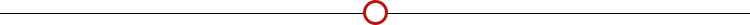
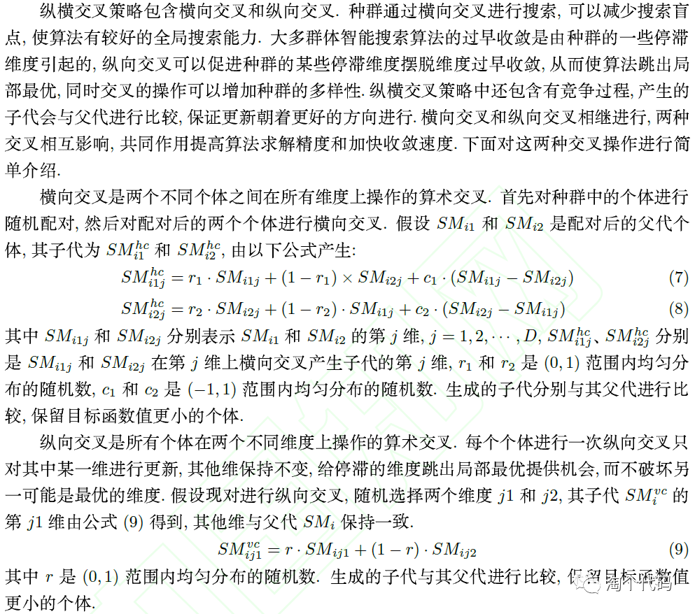
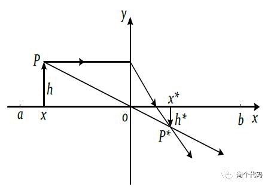

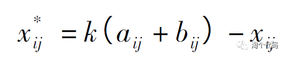
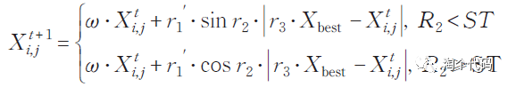
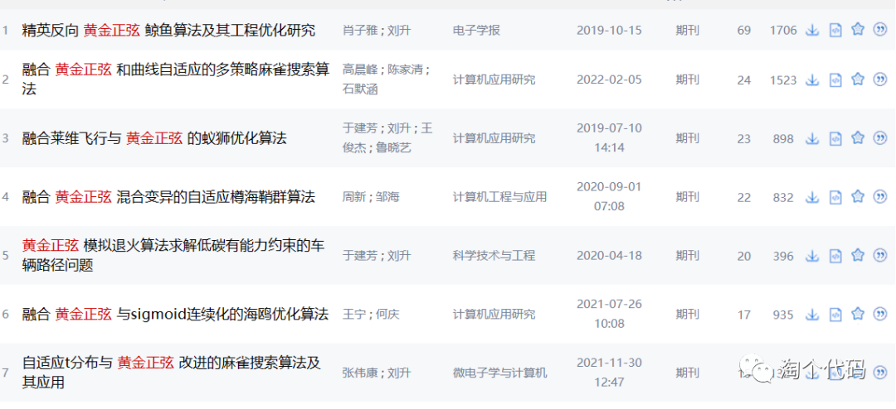
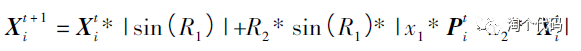
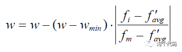
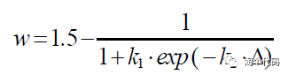
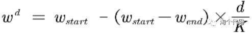
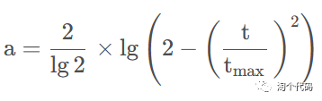
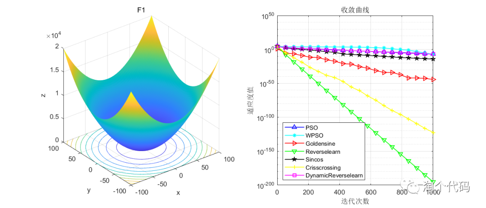
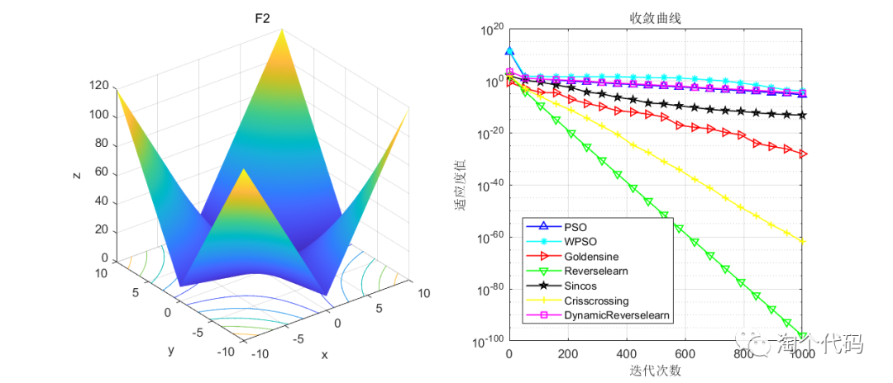
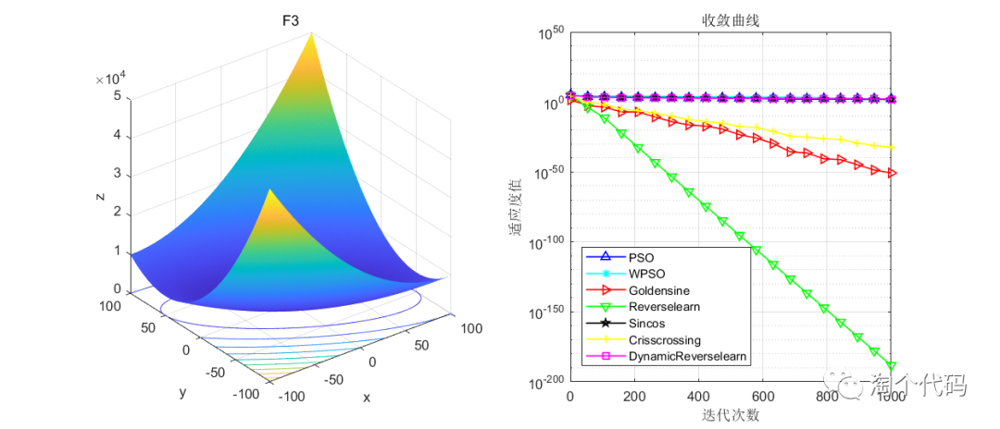
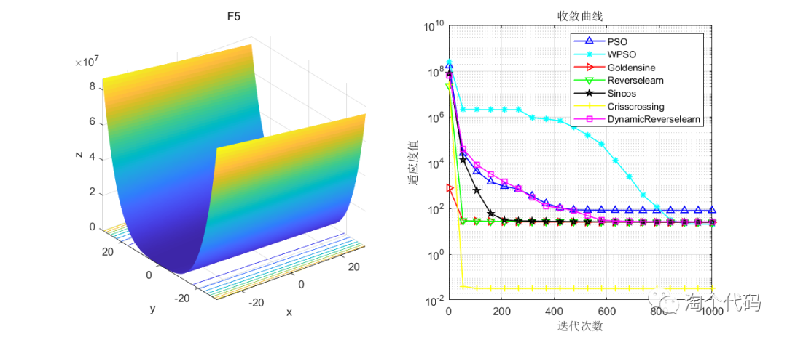
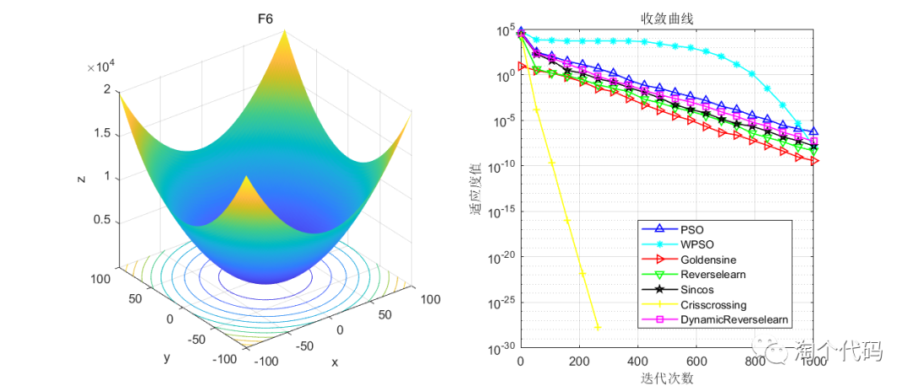
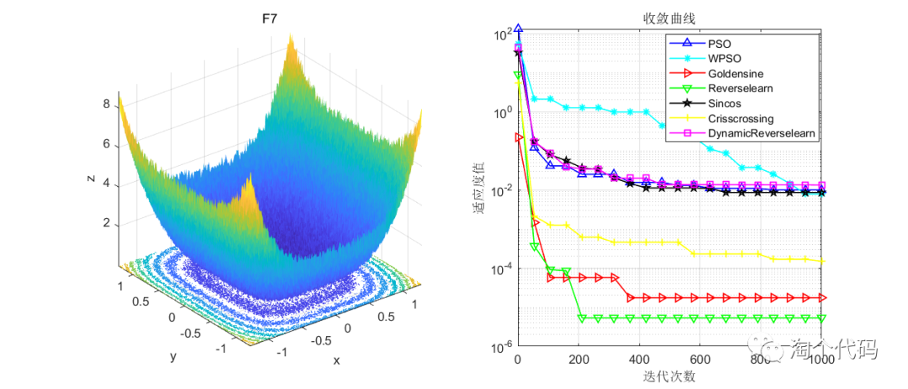
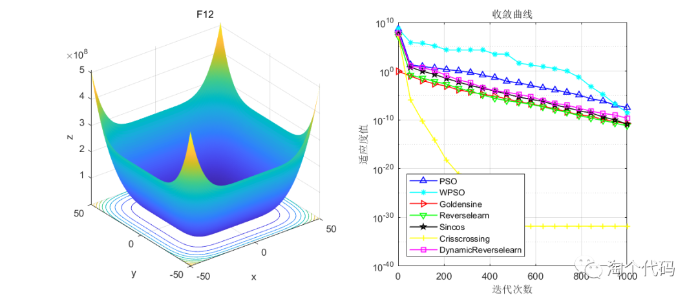
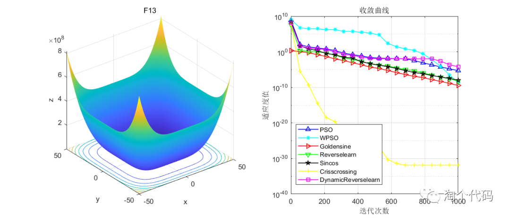
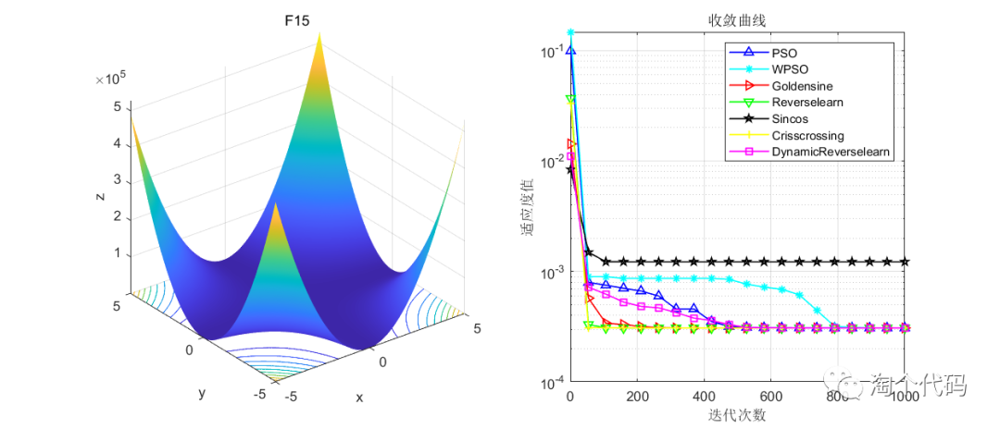
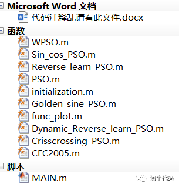

<!-- PAYMENT_BLOCK -->

## Get this dataset

- Payment link (Stripe): [Buy now](https://buy.stripe.com/3cs8yP7sY87d0vu9AB)
- Payment QR code: 

<!-- /PAYMENT_BLOCK -->
